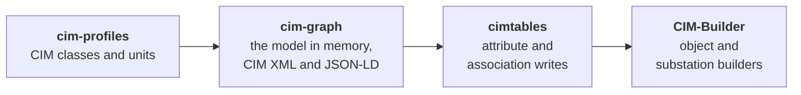

<div class="ct-hero" markdown>

# CIM models built <span class="ct-accent">from scratch</span>

<p class="ct-lede">CIM-Builder writes IEC CIM power system models directly, with no OpenDSS, PSS/E or GIS file to
convert. Build equipment one object at a time, or whole node-breaker substations in a few calls, and insert
existing distribution feeders into them. Everything lands in a
<a href="https://pnnl-cim-tools.github.io/CIM-Graph/">cim-graph</a> model, ready to save as CIM RDF/XML or
JSON-LD.</p>

[Substation builder](02_substation_builder/2_1_substation_builder.ipynb){ .md-button .md-button--primary }
[Object builders](03_object_builder/3_1_object_builders.ipynb){ .md-button }
[Installation](01_overview/1_2_installation.ipynb){ .md-button }
[Developer docs](developer/index.md){ .md-button }

</div>

```python
from cimgraph.utils import write_xml
from cimtables.units import Qty

from cimbuilder.network import new_feeder_model
from cimbuilder.object_builder import BaseVoltageBuilder
from cimbuilder.substation_builder import RingBusSubstationBuilder

network = new_feeder_model(authority="https://example.com/models", model="demo", Feeder="fdr_demo")
BaseVoltageBuilder(network, network.container).create(mRID="bv_115kV", nominalVoltage=Qty(115, "kV"))

builder = RingBusSubstationBuilder(network, network.container)
substation = builder.create(mRID="sub_ring", name="Ring bus")
substation, voltage_level = builder.add_voltage_level(substation, mRID="vl_115", BaseVoltage="bv_115kV")
voltage_level, busbars, ring = builder.add_buses(voltage_level, sections=4)
for section in (1, 2, 3, 4):
    builder.add_branch(voltage_level, section=section, node=f"line_{section}")

write_xml(network, "ring_bus.xml")  # 4 busbars, 4 breakers, 12 disconnectors
```

The builder makes the parts of a node-breaker model that are tedious to write by hand: every
`ConnectivityNode`, `Terminal`, `BusbarSection`, breaker and disconnector, with consistent mRIDs, all in the
right `VoltageLevel` with its `BaseVoltage`.

## Substation layouts

<div class="grid cards" markdown>

-   :material-minus:{ .lg .middle } __Single bus__

    ---

    One bus, a breaker bay per branch. The simplest and cheapest layout.

    [:octicons-arrow-right-24: Single bus](02_substation_builder/2_2_single_bus.ipynb)

-   :material-dots-horizontal:{ .lg .middle } __Sectionalized bus__

    ---

    Bus sections joined by tie breakers, so a bus fault takes out only its own section.

    [:octicons-arrow-right-24: Sectionalized bus](02_substation_builder/2_3_sectionalized_bus.ipynb)

-   :material-swap-vertical:{ .lg .middle } __Main and transfer__

    ---

    A transfer bus and normally open bypasses, to take a branch breaker out for maintenance.

    [:octicons-arrow-right-24: Main and transfer](02_substation_builder/2_4_main_and_transfer.ipynb)

-   :material-equal:{ .lg .middle } __Double bus, single breaker__

    ---

    Two buses, each branch switched onto either one by its bus selectors.

    [:octicons-arrow-right-24: Double bus, single breaker](02_substation_builder/2_5_double_bus_single_breaker.ipynb)

-   :material-circle-outline:{ .lg .middle } __Ring bus__

    ---

    Bus sections in a closed loop of breakers. Any one breaker can open without an outage.

    [:octicons-arrow-right-24: Ring bus](02_substation_builder/2_6_ring_bus.ipynb)

-   :material-ladder:{ .lg .middle } __Breaker and a half__

    ---

    Diameters of three breakers between two buses, two branches per diameter.

    [:octicons-arrow-right-24: Breaker and a half](02_substation_builder/2_7_breaker_and_half.ipynb)

</div>

Each layout page inserts the IEEE 13 node test feeders into a new 115 kV substation, writes the result to
CIM XML and reads it back.

## Equipment, one object at a time

Underneath the layouts, there is one [object builder](03_object_builder/3_1_object_builders.ipynb) per CIM
class: lines, switches, transformers and regulators, loads and capacitors, sources, generators and
inverters, and their measurements and limits. Each one creates the object, then fills it in one CIM
profile part at a time, with values in any unit. [A feeder from scratch](03_object_builder/3_2_feeder_from_scratch.ipynb)
builds a complete small feeder this way.

## Where it fits



CIM-Builder is one of the [PNNL CIM tools](https://github.com/PNNL-CIM-Tools), alongside
[CIM-Graph](https://pnnl-cim-tools.github.io/CIM-Graph/) and
[CIM-Tables](https://pnnl-cim-tools.github.io/CIM-Tables/).
